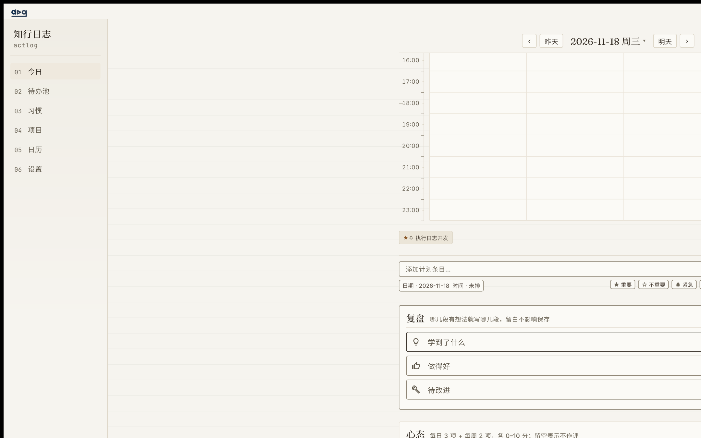
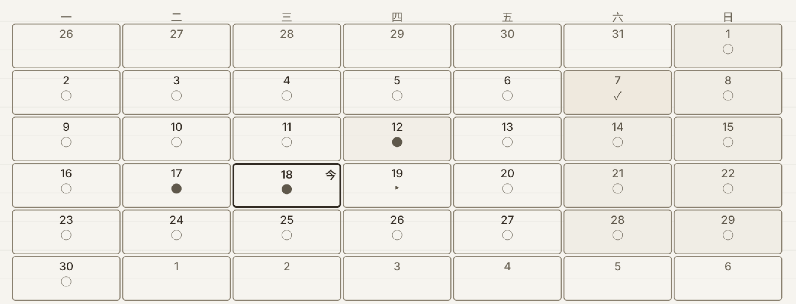

# 知行日志 · actlog

> 把「目标 — 计划 — 执行 — 复盘」变成**每天可记录、事后可追溯**的日常数据。

[](#)
[](#)
[](#)
[](https://github.com/kizemo/actlog/actions/workflows/ci.yml)

**知行日志（actlog）** 是一个面向个人的 Windows 桌面效能工具。它以《高绩效人士的五项管理》为信息架构骨架，把「今天打算做什么、实际做了什么、事后复盘出什么」这三段事实**逐条落库**，让周复盘、月回看有数据可查，而不是凭记忆。

**它不是又一个任务清单。** 任务清单只回答「做完没做完」；知行日志还要回答「占用了哪段时间」「结果写成什么」「心态在哪几个维度上失守」。

- 本地 SQLite 是**唯一真相源**，离线是常态而不是降级；
- **没有账号体系**，不需要注册、不上传、不联网也能用全部功能；
- 同步按记录级 `oplog` 增量设计（写入层已就位，同步引擎属后续里程碑）。

> 本文档只描述仓库里**真实存在**的形态。没有实现的功能一律标「未开始」，没有可引用的截图就写「待补」——不写规划稿当成已完成。

---

## 目录

- [核心特性](#核心特性)
- [界面截图](#界面截图)
- [架构](#架构)
- [目录结构](#目录结构)
- [开发与构建](#开发与构建)
- [打包与分发](#打包与分发)
- [测试与门禁](#测试与门禁)
- [数据主权与隐私](#数据主权与隐私)
- [路线图](#路线图)
- [贡献](#贡献)
- [许可证](#许可证)
- [致谢](#致谢)

---

## 核心特性

### 今日页：方格网格（计划表格化）

今日页的主体是**方格网格**（`day-grid`）：一天按时间格铺开，条目占住具体一段时间，拖动即可排期。网格上方是表头行，**最左单元格放日期**、时间刻度作为最左列，表头 / 刻度 / 条目层三者的左边缘对齐——它读起来是一张**表格**，而不是一圈散落的卡片。

没排期的条目落在网格下方的**未排期带**（`unscheduled-strip`）：数据不丢，随时可以拖进格子。

### 手写条：一个输入框 + 一个合并按钮

新增条目只有一行：输入框 + `+ 手写一条`。**日期与时刻合并成一个按钮**（`add-plan-datetime-button`，内部是日期 / 时刻两枚子芯片，可单独清除时刻），与**重要 / 紧急**芯片同一行——一行读下来就是三个判断：写在哪天几点、有多重要、有多紧急。

### 优先级：同轴同图标，只分填充 / 空心

- 重要性轴 → 星：**重要** = `Icons.star`（实心）、**不重要** = `Icons.star_border`（空心）；
- 紧急度轴 → 铃：**紧急** = `Icons.notifications`（实心）、**不紧急** = `Icons.notifications_none`（空心）。

同一条轴上的两个状态共用**同一个字形轮廓**，只有填充与否的区别，扫一眼就知道是哪一轴、取哪一值。未分级的条目不渲染标记、也不留空位，不污染排版。

### 删除一律二次确认

计划条目、循环任务规则的删除都先弹共享确认框（`confirm-dialog-cancel` / `confirm-dialog-confirm`）：**取消 ⇒ 一行都不动**，确认后才落软删。软删写的是墓碑，不物理删行。

### 循环任务：只留规则区，不再重复列「今日」

右栏「循环任务」模块只展示**规则**（含已停用的）与规则数计数（`recurring-rules-count`）。到日子自动把当天实例填进计划，物化是幂等的。

此前这里会把已删除的条目又列一遍 —— 根因是查询 occurrence 时没有过滤 `deletedAt`，且删除 `plan_item` 不联动 occurrence。现在**过滤软删 + 删除计划项时联动软删 occurrence**，重复展示已消除，「今日」列表整段移除（计划项只在计划区出现，不重复）。

### 复盘：内容左对齐，只留三问

复盘段不再套左栏包装，内容直接左对齐、与正文同一条基线；去掉「已闭合」「晚 · 复盘与心态」这类阶段性标签，也不再出现「今日失守」行与「可控 / 不可控 / 下一步可控动作」三段输入。留下的是**学到了什么 / 做得好 / 待改进**三问，与结果笔记一起进库、进日历回看。

### 心态：豆包 3+2

心态不再是一个模糊的「今天心情如何」，而是按日 / 周两个粒度拆开：

- **日 3 项**：履约负责、高效高质、积极思维；
- **周 2 项**：自我效能、利他贡献。

五项**映射到既有的 8 个 legacy 列**（老数据零丢失，不是新表），「明日改进点」写入 `next_action` 列。落库口径由数据层统一，界面只负责选。

### 日历：突出今天、区分非工作日

月视图用上此前算好却没用到的 `isWeekend` 判定：**今天**用 ≥2 个信号（边框 + 底色 / 标签，另有 ValueKey）标出，**非工作日**做可判别的弱化。今天恰逢周末时两个信号叠加不冲突。

### 主题：暖褐灰，去掉了所有蓝调

原主色是钢蓝系（`#2E4057` / `#3D5170` / `#E7EAEF` …），与「账本纸」的暖白底不协调。现在统一改成暖褐灰：

| 令牌 | 旧值 | 现值 |
|---|---|---|
| `ink` | `#2E4057` | `#322B23` |
| `ink2` | `#3D5170` | `#4A4036` |
| `inkWash` | `#E7EAEF` | `#EFE9DE` |
| `slotPlan` | `#E8ECF1` | `#EBE5D8` |
| `slotHabit` | `#DCE4EC` | `#E2DACB` |

强调色仍是赭石系，未改动。色板真源与推导记录见 [`design-demos/TOKENS.md`](design-demos/TOKENS.md)。

### 习惯

习惯打卡条、习惯速览面板（右栏）、习惯快捷创建对话框。习惯与「计划」是两种不同实体：计划有具体时间占用，习惯有连续性与断点，混在一起会同时毁掉两边。删除习惯回填行只写 `plan_item` 墓碑，**不触碰打卡记录**。

### 桌面端

- **账本纸视觉语言**：暖白底、细分隔线、克制的分组卡片，接近纸质手账，而不是仪表盘；
- **系统托盘**：关窗即隐藏到托盘（不是退出），左键切换窗口、右键菜单可把窗口拉回桌面；
- **`--selftest` 自检开关**：无界面交互即可自证核心链路（迁移 / 读写 / 软删隔离 / 设置往返）；
- 字号（文本缩放）与密度档位可调。

### 规划与设计文档

仓库里有三份 Task 40 产出的设计/规划文档，都是**文档形态**、尚未实施：

- [`docs/task40/模块优化建议.md`](docs/task40/模块优化建议.md) —— 逐模块「问题 → 建议 → 依据 → 优先级 → 预估改动面」；
- [`docs/task40/项目页规划.md`](docs/task40/项目页规划.md) —— 项目页信息架构、≥2 种与计划主页的整合模型、schema 评估与 P0/P1/P2 路线（**本轮不实施**，`nav_rail` 的「项目」入口仍保持禁用）；
- [`docs/task40/关于页设计.md`](docs/task40/关于页设计.md) —— 关于页规格 + 当前实现与规格的差距清单（本轮不改代码）。

---

## 界面截图

以下截图取自 **Task 40 release 产物的真机运行画面**（`release\actlog-Setup-1.0.0_20261118-163228.exe` 覆盖安装后启动），在**默认桌面**会话中经 `PrintWindow` 取帧，并按「目标进程 = `actlog.exe`、宽高 ≥ 400×300、回读 PNG 尺寸」三重过滤校验后才采信。

### 今日页（首屏）


### 今日页（下半屏：手写条 / 复盘 / 心态）



手写条的「日期 · 时间」已合并为**一个按钮**，与重要、紧急同行；重要 / 不重要用**同一个星形图标**（实心 / 空心区分），紧急 / 不紧急用**同一个铃形图标**（实心 / 空心区分）：


### 日历页（今天描边 + 非工作日底色）




> `design-demos/` 下是 v1 / v2 的**设计原型**，与现在的网格化实现差距明显，因此**没有**拿原型充当现状截图。

---

## 架构

四层，依赖方向单向向下：

```
┌────────────────────────────────────────────────────────────┐
│  apps/desktop          Flutter (Windows) 壳 + 全部界面      │
│                        今日页 / 方格网格 / 右栏 / 日历      │
└──────────────────────────┬─────────────────────────────────┘
                           │ 只依赖下面三个纯 Dart 包
┌──────────────────────────▼─────────────────────────────────┐
│  core_data    仓储与业务逻辑：计划 / 习惯 / 循环 / 心态      │
│               无 UI 依赖                                    │
├────────────────────────────────────────────────────────────┤
│  core_db      drift 表定义 / 迁移 / oplog 写入层             │
│               含约束「有牙」测试与 schema 一致性测试          │
├────────────────────────────────────────────────────────────┤
│  core_domain  纯 Dart 领域模型：实体 / 枚举 / 不变量          │
│               零 IO 依赖                                    │
└────────────────────────────────────────────────────────────┘
```

| 决策 | 内容 | 理由 |
|---|---|---|
| 客户端 | Flutter 3.47.9 / Dart 3.13.7 | 一套代码覆盖 Windows（Android 属 P6） |
| 数据库 | drift + SQLite | 类型安全、迁移可版本化；生成的 `*.g.dart` 是 schema 的类型级镜像 |
| 状态管理 | Riverpod | 依赖注入 + 测试友好，适配「本地库 + 同步引擎」双数据源 |
| 数据真相源 | **本地 SQLite 唯一权威** | 服务端只做中继与备份，断网必须完全可用 |
| 同步 | **记录级 oplog 增量** | 每次写留痕（upsert / delete + lamport + 设备标识）；必须在建库时就埋好 |
| 账号体系 | **不做** | 个人场景；同步走局域网直连 / WebDAV |
| Schema | v1 **FROZEN**（[`docs/schema_v1.sql`](docs/schema_v1.sql)） | 14 张表；改表需要显式迁移，不许顺手改 |

**为什么领域层要单独成包**：双端一致的唯一可靠实现是「只有一份领域逻辑」。两端各写一遍实体和枚举，迟早在某个边界值上分歧；而这类 bug 在同步场景里表现为**静默的数据损坏**，不是崩溃。

---

## 目录结构

```
actlog/
├── apps/
│   └── desktop/                     # 正式 Windows 桌面应用（Flutter）
│       ├── lib/src/pages/           # 今日 / 待办池 / 习惯 / 日历 / 关于 / 设置
│       ├── lib/src/widgets/         # 方格网格 / 优先级标记 / 右栏面板 / 确认框
│       │   └── timeline/            # day_grid / day_timeline / slot_state / timeline_store
│       ├── lib/src/theme/           # 设计令牌 / 字体 / 密度档位
│       ├── lib/src/selftest.dart    # --selftest 自检链路
│       └── test/                    # widget / 回归 / 端到端用例
├── packages/
│   ├── core_domain/                 # 纯 Dart 领域模型（零 IO）
│   ├── core_db/                     # drift schema + 迁移 + oplog 写入层
│   ├── core_data/                   # 仓储与业务逻辑
│   ├── core_sync/                   # oplog 同步协议（未开始）
│   ├── core_backup/                 # 快照 / 导出 / 导入（未开始）
│   └── core_ui/                     # 共享 UI 组件（未开始）
├── tools/
│   ├── bootstrap.ps1                # 幂等环境准备（找 SDK / 设镜像 / pub get）
│   ├── gates/                       # 质量门禁 G1–G3
│   │   ├── g1_analyze.ps1           # 静态分析（逐字 No issues found!）
│   │   ├── g2_unittest.ps1          # 单元测试
│   │   ├── g3_migration.ps1         # 迁移 + schema 自检（含「故意破坏」有牙测试）
│   │   ├── g3_schema_check.mjs      # schema 校验器（node:sqlite 实跑）
│   │   └── bad-fixtures/            # 故意破坏的坏数据样例与自检
│   ├── build/make_installer.ps1     # NSIS 安装包构建
│   ├── icons/make_brand_icon.py     # 程序化生成图标（PNG + 多尺寸 ICO）
│   └── verify/                      # 真机证据脚本（托盘 / 冒烟 / 装机核对 / 取帧）
├── docs/                            # 计划 / schema / 验收记录 / Task 40 设计文档
├── design-demos/                    # 设计原型与令牌真源（TOKENS.md）
├── reports/                         # 门禁与真机证据脚本、产物
├── .github/workflows/ci.yml         # CI：G1 / G2 / G3
├── pubspec.yaml                     # Dart pub workspace 根
└── analysis_options.yaml            # 静态分析规则（unused_* 提升为 error）
```

---

## 开发与构建

**依赖**：Flutter 3.47.9（自带 Dart 3.13.7）、Node ≥ 22.5（G3 用 `node:sqlite` 实跑 SQLite）。

**国内镜像必须在当前进程内设置**（子进程不会继承已经 export 过的值，每次开新终端都要重设）：

```powershell
$env:PUB_HOSTED_URL='https://pub.flutter-io.cn'
$env:FLUTTER_STORAGE_BASE_URL='https://storage.flutter-io.cn'
```

一键准备（幂等，可重复运行）：

```powershell
pwsh -File tools/bootstrap.ps1
```

脚本会：定位 Flutter / Dart（找不到就打印中文安装指引并以退出码 2 结束）→ 仅当前进程设置镜像 → `flutter doctor`（仅提示，不阻断）→ `flutter pub get`。

**静态分析与测试**（`apps/desktop` 是 Flutter 壳，不进 Dart workspace，必须在这里单独跑）：

```powershell
$env:PUB_HOSTED_URL='https://pub.flutter-io.cn'; $env:FLUTTER_STORAGE_BASE_URL='https://storage.flutter-io.cn'
& 'F:\soft\flutter\flutter\bin\flutter.bat' analyze      # 期望逐字 No issues found!
& 'F:\soft\flutter\flutter\bin\flutter.bat' test --reporter compact
```

**跑全量之前先把上一轮的测试缓存改名挪走**（`Move-Item`，不要删）。留在原地会让测试进程撞 `OS Error 183` 并挂死：

```powershell
Move-Item .\apps\desktop\build\test_cache\build .\apps\desktop\build\test_cache\build.bak
```

> 并发跑多个 worker 时不要跑全量，只跑自己改动到的那个测试文件（`flutter test test/xxx_test.dart --reporter compact`），全量由单一入口统一跑。

跑门禁（退出码 0 = 通过，非 0 = 阻断）：

```powershell
pwsh -File tools/gates/g1_analyze.ps1     # 静态分析：逐字 No issues found!
pwsh -File tools/gates/g2_unittest.ps1    # 单元测试：输出通过 / 失败用例数
pwsh -File tools/gates/g3_migration.ps1   # 迁移 + schema 自检 + 有牙测试

# 单跑 schema 校验 / 坏数据自检（Node，不依赖 Dart）
node tools/gates/g3_schema_check.mjs
node tools/gates/bad-fixtures/self_test.mjs
```

门禁脚本兼容 Windows PowerShell 5.1 与 PowerShell 7，也可在 Linux 上用 `pwsh` 直接跑（CI 即如此）。

---

## 打包与分发

安装包由 NSIS 生成，双击即装、免管理员，装到 `%PROGRAMFILES%\actlog`，建开始菜单与桌面快捷方式；中文显示名保留「知行日志」。

```powershell
pwsh -File tools/build/make_installer.ps1
```

**当前唯一可分发包**：

```
release\actlog-Setup-1.0.0_20261119-231728.exe     16,130,618 B
```

> `release` 下其余历史包**全部失效，不得分发**。其中包括 `..._20261119-000839.exe` —— 它已被上面这个包取代（该包不含 Task 45 的主界面六项改造与关于页），仅供回溯，**不可再分发**。

装机核对的判据不是「装完能点开」，而是**二进制一致**：装机目录 `app\data\app.so` 与 `actlog.exe` 的 sha16 必须等于构建产物，且 8 个用户数据文件逐一哈希一致（零丢失）。脚本见 `tools/verify/`，流水记录见 [`docs/B1_验收记录.md`](docs/B1_验收记录.md)。

**发布 GitHub Release 不在仓库流程内自动执行**，需要项目所有者单独确认。

---

## 测试与门禁

| 门禁 | 内容 | 判断标准 |
|---|---|---|
| G1 | 静态分析 | **逐字** `No issues found!`（error / warning / info 全 0） |
| G2 | 单元测试 | 全绿，用例数**只增不减** |
| G3 | 空库 → v1 迁移 + schema 一致性 + 约束有牙 | 迁移成功 **且** 中和约束后必须失败 |

**用例数基线**（新增用例只许往上加，不许为了让流水绿而删用例或放宽断言）：

| 目标 | 基线 |
|---|---|
| `apps/desktop`（`flutter test`） | `+432` |
| `packages/core_data`（`dart test`） | `+197` |
| `packages/core_db` | `+71` |
| `packages/core_domain` | `+62` |

三条硬规矩：

1. **门禁必须先证明自己「有牙」**。G3 会把 `schema_v1.sql` 里的 `CHECK` 约束全部中和成 `CHECK (1=1)` 再跑一遍冒烟测试，**这时候必须失败**；如果反而通过，门禁判定自己无效并以失败退出。详见 [`tools/gates/bad-fixtures/README.md`](tools/gates/bad-fixtures/README.md)。
2. **判据不接受关键词计数**。`No issues found!` 是逐字比较，不是「grep 一下没有 error 就算过」。
3. **拿不到证据就写「未做」**。验收记录里明确区分「已验证 / 推断 / 未验证」，没跑过的一律不写成跑过。

CI（[`.github/workflows/ci.yml`](.github/workflows/ci.yml)）在 push / PR 到 `main` 时以矩阵方式跑 G1、G2、G3，三个门禁全绿才算通过。

---

## 数据主权与隐私

- **默认零网络**：不注册、不上传、不采集。断网机器上功能完整。
- **账本在你自己的磁盘上**：一个 SQLite 文件，用任何工具都能打开、备份、迁移。
- **同步目标由你指定**：局域网直连或你自己的 WebDAV，不存在「必须信任我们的服务器」。
- **升级不覆盖账本**：安装器就地 `Rename` 安装目录，`userdata` 原地保留；旧 `userdata` 与旧库名保留兼容读取，迁移过程打印 `ACTLOG_MIGRATE=RENAME_OK` 作为「迁移成功」的证据。

关于产品改名（`practilog` → `actlog`）：这是**就地改名而非重建**——安装目录 `Rename`、不删不建，账本原样保留。改名路径见 [`docs/B1_验收记录.md`](docs/B1_验收记录.md)。

---

## 路线图

| 事项 | 状态 | 说明 |
|---|---|---|
| Task 40 的 13 项产品改造 | 本轮交付 | 计划表格化 / 手写条合并 / 优先级同图标 / 复盘重排 / 主题去蓝 / 心态 3+2 / 循环去重 / 删除确认 / 日历今天与非工作日 / 三份设计文档 / README |
| **Task 41 深色主题** | 下一轮 | 架构级 token 改造：需要第二套 token 组 + 41 个文件约 **724 处** `AppTokens.*` 引用改造；`timeline_contrast_test.dart` 以 epsilon 0.005 钉死四态色值，混轮做必然半深半浅，所以独立排期、不并入本轮 |
| 深色主题之外的视觉细节 | 未开始 | 见 [`docs/task40/模块优化建议.md`](docs/task40/模块优化建议.md) 的 P1 / P2 |
| 项目页 | 规划完成、未实施 | 见 [`docs/task40/项目页规划.md`](docs/task40/项目页规划.md)；「项目」导航入口仍禁用 |
| `apps/android` | 未开始 | P6；领域层与 schema 已按双端一致设计 |
| `core_sync` / `core_backup` | 未开始 | P5（同步协议）/ P4（快照导出导入） |
| G4–G8 门禁 | 未开始 | 导出等价 / 同步幂等 / 双端一致 / 离线可用 / 快照可恢复 |
| 覆盖率阈值 | 未硬性强制 | 计划 ≥ 70%，需要 `coverage` 包 |

**已知但不影响使用的事项**：

1. `apps/desktop` 刻意不进 Dart workspace（Flutter 壳通过 path 依赖指向三个纯 Dart 包），所以它的 analyze / test 必须在 `apps/desktop` 目录内单独用 `flutter` 跑。
2. `window_manager` / `tray_manager` 仍用 legacy 桥接 API（官方标记 deprecated），原生 API 迁移留到后续。
3. 托盘图标只在进程存活期存在；任务栏 `^` 里看不到图标时，第一嫌疑是**进程没在跑**，判据用 `tools/verify/tray_alive_check.ps1`。
4. 高 DPI：125% / 100% 显示缩放下的真机取帧尚未完成，目前只覆盖 150%。
5. Android 端未开始，「双端一致」目前只有领域模型与数据库契约层面的保证，还没有第二端实测。

---

## 贡献

1. 改动前先读 [`AGENTS.md`](AGENTS.md)（工程铁律）与 [`docs/开发计划.md`](docs/开发计划.md)（里程碑与判据）；两者冲突时以当轮派工契约为准。
2. **`docs/schema_v1.sql` 是 FROZEN 的**：不新增表、不改列、不改约束。确实需要改表，先落迁移脚本与迁移测试。
3. **不新增依赖**，除非能说明现有依赖无法胜任。
4. 提交前至少跑一次：

   ```powershell
   $env:PUB_HOSTED_URL='https://pub.flutter-io.cn'; $env:FLUTTER_STORAGE_BASE_URL='https://storage.flutter-io.cn'
   & 'F:\soft\flutter\flutter\bin\flutter.bat' analyze
   ```

   期望逐字 `No issues found!`。
5. **断言只许改强**：修 bug 时不许删用例、不许放宽阈值、不许用 `warnIfMissed: false` 之类的手法让断言「看起来通过」。
6. 证据优先：报「已修复」要附实测输出（逐字计数行 / 退出码），没有证据就写「未验证」。

---

## 许可证

**本仓库未声明开源许可证。**

- 仓库根目录没有 `LICENSE` / `COPYING` 文件；
- 5 个 `pubspec.yaml` 均未声明 `license` 字段。

按默认版权规则，**保留所有权利**（All rights reserved）：未经项目所有者书面许可，不得复制、分发、修改或用于商业用途。若将来要开源，需要先补 `LICENSE` 文件并在此处同步声明——在补上之前，请不要把本仓库当作可自由使用的开源项目。

---

## 致谢

- [Flutter](https://flutter.dev/) / [drift](https://drift.simonbinder.eu/) / [Riverpod](https://riverpod.dev/) —— 客户端、数据库与状态管理的基座。
- [NSIS](https://nsis.sourceforge.io/) —— Windows 安装包。
- 《高绩效人士的五项管理》：本项目以其方法论为**信息架构骨架**，做的是工程化实现，不是原书复刻。需要说清楚的两点：
  - **ABC 优先级**（A 类 = Q1 + Q2 = 重要且紧急）沿用原书体系；
  - **四象限（Q1–Q4）来自艾森豪威尔矩阵**，在本项目中是辅助的分类视图，**不得宣称来自该书原书**；「站会三段」「复盘」「心态 3+2」同样是工程化实现。
  - 仓库**不包含**原书正文。
- 所有把「测试通过」当证据而不是当口号的实践者。