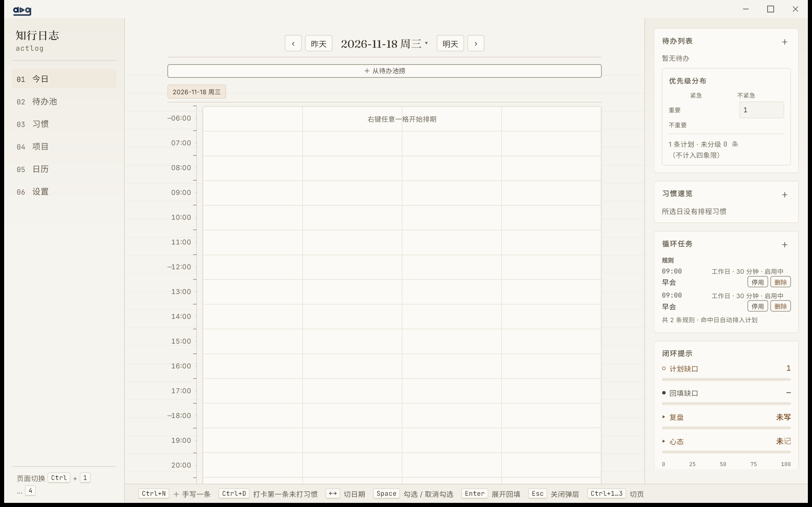
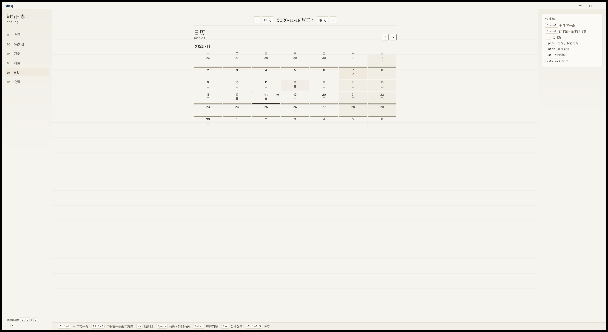

[](README.md) [](README.zh-CN.md)

# Actlog · 知行日志

> Turn "goal — plan — execute — review" into **daily data you can record today and trace back later.**

[](#)
[](#)
[](#)
[](https://github.com/kizemo/actlog/actions/workflows/ci.yml)

**Actlog (知行日志)** is a personal Windows desktop productivity tool. It uses *The Five Management Disciplines* as its information-architecture backbone and stores three kinds of facts as **individual rows in a local database**: what you planned to do today, what you actually did, and what you concluded when reviewing the day. Weekly reviews and monthly look-backs then have data to read instead of memory to trust.

**It is not yet another to-do list.** A to-do list only answers "did it get done?". Actlog also answers "which hours did it consume", "what was written down as the outcome", and "on which dimensions did my state of mind slip".

- The local SQLite database is the **single source of truth**; being offline is the normal case, not a degraded mode;
- **No account system** — no sign-up, no upload, and every feature works with the network unplugged;
- Sync is designed as a **record-level `oplog` delta** (the write layer is already in place; the sync engine is a later milestone).

> This document describes only what **actually exists** in the repository. Anything unimplemented is marked "not started", and anything without a citable screenshot is marked "to be added" — planning notes are never presented as finished work.

---

## Table of contents

- [Core features](#core-features)
- [Screenshots](#screenshots)
- [Architecture](#architecture)
- [Repository layout](#repository-layout)
- [Development and build](#development-and-build)
- [Packaging and distribution](#packaging-and-distribution)
- [Testing and gates](#testing-and-gates)
- [Data ownership and privacy](#data-ownership-and-privacy)
- [Roadmap](#roadmap)
- [Contributing](#contributing)
- [License](#license)
- [Acknowledgements](#acknowledgements)

---

## Core features

### Today page: the cell grid (planning turned into a table)

The body of the Today page is a **cell grid** (`day-grid`): the day is laid out in time cells, each entry occupies a concrete span of time, and dragging schedules it. Above the grid sits a header row whose **leftmost cell holds the date**, with the time scale as the leftmost column, so the left edges of the header, the scale, and the entries all line up — it reads as a **table**, not as a ring of scattered cards.

Unscheduled entries fall into the **unscheduled strip** below the grid: nothing is lost, and they can be dragged into a cell at any time.

### The quick-entry bar: one field, one merged button

Adding an entry takes a single row: a text field plus `+ 手写一条`. **Date and time are merged into one button** (`add-plan-datetime-button`, which internally holds two sub-chips for date and time, and the time chip can be cleared on its own), sitting on the same row as the **important / urgent** chips — one line, three decisions: which day and hour, how important, how urgent.

### Priority: one glyph per axis, filled versus hollow

- Importance axis → star: **important** = `Icons.star` (filled), **not important** = `Icons.star_border` (hollow);
- Urgency axis → bell: **urgent** = `Icons.notifications` (filled), **not urgent** = `Icons.notifications_none` (hollow).

The two states of one axis share **the same glyph outline**, differing only in fill, so a glance tells you which axis you are reading and which value was taken. Unrated entries render no marker and reserve no space, so they never pollute the layout.

### Every delete asks twice

Deleting a planned entry or a recurring-task rule always pops the shared confirmation dialog (`confirm-dialog-cancel` / `confirm-dialog-confirm`): **cancel ⇒ not a single row changes**; only after confirming does a soft delete land. Soft delete writes a tombstone, it does not physically remove rows.

### Recurring tasks: rules only, no duplicate "Today" list

The right-rail "Recurring tasks" module shows **rules only** (including deactivated ones) plus a rule count (`recurring-rules-count`). When a day comes, that day's instance is materialised into the plan, and materialisation is idempotent.

This panel used to list deleted entries a second time — the root cause was that the occurrence query did not filter `deletedAt`, and deleting a `plan_item` did not cascade to its occurrences. Now it **filters soft deletes and soft-deletes occurrences along with the plan item**, the duplicate listing is gone, and the "Today" list was removed entirely (planned items appear only in the planning area).

### Projects page: projects / schedule / milestones / increments

The "Projects" entry in the left rail (`Ctrl+5`) opens the projects page. Projects carry a start–end range, and the detail view renders it as a **Gantt chart** with range bars and single-day milestone blocks (no new dependency, drawn with `CustomPaint`).

The project detail and each increment row carry a "schedule into today" button, and both go through the same write path to become a `plan_item` on the chosen day (`source_type='project'|'increment'` plus `source_id`). The review section can "record into the project", which **only appends** an increment (a mistake can be corrected by appending a correction, there is no edit entry point). When a project has seen no increment for three days, the Today page shows one **gentle** stall hint in the right rail (not red, no dialog, dismissible).

### Review: left-aligned content, three questions only

The review section no longer wraps its content in a left column; it is left-aligned and shares the text baseline. The stage labels ("closed", "evening · review and state of mind") are gone, as are the "today's slip-ups" row and the three separate inputs (controllable / uncontrollable / next controllable action). What remains is three questions — **what I learned / what went well / what to improve** — stored together with the outcome note and carried into the calendar look-back.

### State of mind: the "3 + 2" model

State of mind is no longer a vague "how was today". It is split into two granularities:

- **Daily 3 items**: keeping commitments, working with high efficiency and quality, positive thinking;
- **Weekly 2 items**: self-efficacy, contribution to others.

The five items **map onto the 8 existing legacy columns** (no data loss, no new table), and "tomorrow's improvement" is written into the `next_action` column. The data layer owns the mapping; the UI only chooses.

### Quote banner: one random line, bilingual

Below the date bar on the home page, a random famous quote or proverb appears (three themes — capability,境界, success — 450 bilingual entries in total), centred, with a refresh button on the right to swap it. Chinese locales show the Chinese and English lines, English locales show English only, and over-long lines scroll from right to left.

### Calendar: today stands out, non-working days recede

The month view now uses the `isWeekend` flag that had been computed but unused: **today** is marked with at least two signals (border plus background/label, plus a distinct ValueKey), and **non-working days** are weakened in a recognisable way. When today happens to be a weekend, the two signals stack without conflict.

### Theme: warm brown-grey, all the blue removed

The original primary palette was steel blue (`#2E4057` / `#3D5170` / `#E7EAEF` …), which clashed with the warm off-white of "ledger paper". It is now uniformly warm brown-grey:

| Token | Old value | Current value |
|---|---|---|
| `ink` | `#2E4057` | `#322B23` |
| `ink2` | `#3D5170` | `#4A4036` |
| `inkWash` | `#E7EAEF` | `#EFE9DE` |
| `slotPlan` | `#E8ECF1` | `#EBE5D8` |
| `slotHabit` | `#DCE4EC` | `#E2DACB` |

The accent colour is still in the ochre family and was not changed. The palette source of truth and its derivation notes live in `design-demos/TOKENS.md` (a local development directory, not shipped with the public repository).

### Habits

The habit check-in strip, the habit quick-look panel in the right rail, and the quick habit creation dialog. A habit and a "plan" are two different entities: a plan occupies concrete time, a habit has continuity and breaks — mixing them ruins both. Deleting a habit's backfill row writes a `plan_item` tombstone and **never touches the check-in records**.

### Desktop shell

- **Ledger-paper visual language**: warm off-white ground, thin separators, restrained grouping cards — closer to a paper notebook than to a dashboard;
- **System tray**: closing the window hides it to the tray (it does not quit); left click toggles the window, right click brings it back to the desktop;
- **`--selftest` switch**: proves the core chains (migration / read-write / soft-delete isolation / settings round-trip) with no UI interaction;
- Text scale and density level are adjustable.

### Planning and design documents

The repository holds three design/planning documents produced in Task 40. All are **documents only**, nothing implemented:

- [`docs/task40/模块优化建议.md`](docs/task40/模块优化建议.md) — per module: problem → suggestion → evidence → priority → estimated change surface;
- [`docs/task40/项目页规划.md`](docs/task40/项目页规划.md) — projects-page information architecture, two-plus integration models with the planning home page, schema assessment, and the P0/P1/P2 roadmap (**P0 and P1 shipped with Task 56 / 57**; P2's "project statistics aggregated by domain" is still unimplemented);
- [`docs/task40/关于页设计.md`](docs/task40/关于页设计.md) — about-page specification plus the gap list against the current implementation (no code changed here).

---

## Screenshots

The screenshots below come from **a real machine running the Task 40 release build** (`release\actlog-Setup-1.0.0_20261118-163228.exe`, installed over the top and launched), captured with `PrintWindow` in a **default desktop** session, and accepted only after three filters: target process is `actlog.exe`, width and height ≥ 400×300, and the written-back PNG dimensions match.

### Today page (first screen)



### Today page (lower half: quick entry / review / state of mind)


The quick-entry bar's "date · time" has been merged into **one button**, on the same row as important and urgent; important / not important use **the same star glyph** (filled vs hollow), and urgent / not urgent use **the same bell glyph** (filled vs hollow):


### Calendar page (today outlined + non-working-day shading)




> `design-demos/` holds **design prototypes** (v1 / v2) that differ noticeably from today's grid implementation, so they are **not** used as screenshots of the current product. The projects page and the quote banner have **no screenshot yet (to be added)**.

---

## Architecture

Four layers, dependencies pointing strictly downward:

```
┌────────────────────────────────────────────────────────────┐
│  apps/desktop          Flutter (Windows) shell + all UI     │
│                        Today / grid / right rail / calendar │
└──────────────────────────┬─────────────────────────────────┘
                           │ depends only on the three pure Dart packages below
┌──────────────────────────▼─────────────────────────────────┐
│  core_data    repositories and business logic: plans /       │
│               habits / recurring / state of mind             │
│               no UI dependency                              │
├────────────────────────────────────────────────────────────┤
│  core_db      drift table definitions / migrations / oplog   │
│               write layer, with "teeth" constraint tests     │
│               and schema-consistency tests                  │
├────────────────────────────────────────────────────────────┤
│  core_domain  pure Dart domain model: entities / enums /    │
│               invariants, zero IO dependency                │
└────────────────────────────────────────────────────────────┘
```

| Decision | Choice | Reason |
|---|---|---|
| Client | Flutter 3.47.9 / Dart 3.13.7 | One codebase covers Windows (Android is P6) |
| Database | drift + SQLite | Type-safe, versionable migrations; the generated `*.g.dart` is a type-level mirror of the schema |
| State management | Riverpod | Dependency injection and test friendliness, fitting the "local database + sync engine" dual data source |
| Source of truth | **local SQLite, sole authority** | The server only relays and backs up; offline must be fully usable |
| Sync | **record-level oplog delta** | Every write leaves a trace (upsert / delete + lamport + device id); it has to be built in from day one |
| Accounts | **none** | Personal tool; sync goes over LAN direct connection or your own WebDAV |
| Schema | v1 **FROZEN** ([`docs/schema_v1.sql`](docs/schema_v1.sql)) | 14 tables; changing them needs an explicit migration, no casual edits |

**Why the domain layer is a separate package**: the only reliable way to keep two clients consistent is to have "exactly one copy of the domain logic". Writing the entities and enums twice diverges at some boundary value sooner or later, and in a sync scenario that kind of bug shows up as **silent data corruption**, not a crash.

---

## Repository layout

```
actlog/
├── apps/
│   └── desktop/                     # the shipping Windows desktop app (Flutter)
│       ├── lib/src/pages/           # today / todo pool / habits / calendar / about / settings
│       ├── lib/src/widgets/         # cell grid / priority marks / right-rail panels / confirm dialog
│       │   └── timeline/            # day_grid / day_timeline / slot_state / timeline_store
│       ├── lib/src/theme/           # design tokens / fonts / density levels
│       ├── lib/src/selftest.dart    # the --selftest chain
│       └── test/                    # widget / regression / end-to-end cases
├── packages/
│   ├── core_domain/                 # pure Dart domain model (zero IO)
│   ├── core_db/                     # drift schema + migrations + oplog write layer
│   ├── core_data/                   # repositories and business logic
│   ├── core_sync/                   # oplog sync protocol (not started)
│   ├── core_backup/                 # snapshot / export / import (not started)
│   └── core_ui/                     # shared UI components (not started)
├── tools/
│   ├── bootstrap.ps1                # idempotent environment setup (find SDK / set mirrors / pub get)
│   ├── gates/                       # quality gates G1–G3
│   │   ├── g1_analyze.ps1           # static analysis (verbatim "No issues found!")
│   │   ├── g2_unittest.ps1          # unit tests
│   │   ├── g3_migration.ps1         # migration + schema self-check (with deliberate-breakage "teeth" test)
│   │   ├── g3_schema_check.mjs      # schema checker (really runs on node:sqlite)
│   │   └── bad-fixtures/            # deliberately broken data samples and self-checks
│   ├── build/make_installer.ps1     # NSIS installer build
│   ├── icons/make_brand_icon.py     # programmatic icon generation (PNG + multi-size ICO)
│   └── verify/                      # on-machine evidence scripts (tray / smoke / install check / frame capture)
├── docs/                            # plans / schema / acceptance record / Task 40 design documents
├── design-demos/                    # design prototypes and palette source (TOKENS.md; local, not committed)
├── reports/                         # gate and on-machine evidence scripts and artifacts (local, not committed)
├── .github/workflows/ci.yml         # CI: G1 / G2 / G3
├── pubspec.yaml                     # Dart pub workspace root
└── analysis_options.yaml            # static analysis rules (unused_* promoted to error)
```

---

## Development and build

**Dependencies**: Flutter 3.47.9 (ships Dart 3.13.7), Node ≥ 22.5 (G3 really runs SQLite through `node:sqlite`).

**The China mirror must be set inside the current process** (child processes do not inherit values that were already exported, so it must be set again in every new terminal):

```powershell
$env:PUB_HOSTED_URL='https://pub.flutter-io.cn'
$env:FLUTTER_STORAGE_BASE_URL='https://storage.flutter-io.cn'
```

One-step setup (idempotent, safe to re-run):

```powershell
pwsh -File tools/bootstrap.ps1
```

The script locates Flutter / Dart (if missing it prints installation guidance in Chinese and exits with code 2) → sets the mirrors for the current process only → runs `flutter doctor` (hint only, never blocks) → runs `flutter pub get`.

**Static analysis and tests** (`apps/desktop` is a Flutter shell and is not part of the Dart workspace, so it must be run on its own here):

```powershell
$env:PUB_HOSTED_URL='https://pub.flutter-io.cn'; $env:FLUTTER_STORAGE_BASE_URL='https://storage.flutter-io.cn'
& 'F:\soft\flutter\flutter\bin\flutter.bat' analyze      # expect the verbatim string: No issues found!
& 'F:\soft\flutter\flutter\bin\flutter.bat' test --reporter compact
```

**Move the previous run's test cache out of the way before a full run** (`Move-Item`, do not delete). Leaving it in place makes the test process hit `OS Error 183` and hang:

```powershell
Move-Item .\apps\desktop\build\test_cache\build .\apps\desktop\build\test_cache\build.bak
```

> When several workers run in parallel, do not run the full suite; run only the test files you touched (`flutter test test/xxx_test.dart --reporter compact`). The full run is driven by a single entry point.

Run the gates (exit code 0 = pass, non-zero = blocked):

```powershell
pwsh -File tools/gates/g1_analyze.ps1     # static analysis: verbatim "No issues found!"
pwsh -File tools/gates/g2_unittest.ps1    # unit tests: prints passed / failed counts
pwsh -File tools/gates/g3_migration.ps1   # migration + schema self-check + teeth test

# run the schema check / bad-data self-check alone (Node, no Dart needed)
node tools/gates/g3_schema_check.mjs
node tools/gates/bad-fixtures/self_test.mjs
```

The gate scripts run on Windows PowerShell 5.1 and PowerShell 7, and also run directly under `pwsh` on Linux (which is what CI does).

---

## Packaging and distribution

The installer is produced with NSIS: double-click to install, no administrator rights required, installs into `%PROGRAMFILES%\actlog`, and creates Start menu and desktop shortcuts; the Chinese display name 「知行日志」 is kept.

```powershell
pwsh -File tools/build/make_installer.ps1
```

**The one package that may be distributed right now**:

```
release\actlog-Setup-1.0.0_20261123-094229.exe     22,697,357 B
sha16 (first 16 hex digits) = 4FBE6775A3C43132
```

> `release\` now holds **49 executables; only this one may be distributed — the other 48 must not be**. The previous truth source `..._20261120-100448.exe` (Task 48 close-out build) has been superseded and **must no longer be distributed**.

The install check is not "it opens after installing" but **binary identity**: the sha16 of `data\app.so` in the install directory must equal the build artifact's, and every user data file must hash identically (zero loss). The scripts live in `tools/verify/`, and the running record is [`docs/B1_验收记录.md`](docs/B1_验收记录.md).

**Publishing a GitHub Release is not part of the automated repository flow**; it requires the project owner to confirm separately.

---

## Testing and gates

| Gate | Content | Pass criterion |
|---|---|---|
| G1 | Static analysis | **verbatim** `No issues found!` (zero error / warning / info) |
| G2 | Unit tests | All green, and the case count may only **grow** |
| G3 | Empty database → v1 migration + schema consistency + constraints have teeth | Migration succeeds **and** it must fail once the constraints are neutralised |

**Test count baselines** (new cases may only be added; never delete cases or loosen assertions to make the pipeline green):

| Target | Baseline |
|---|---|
| `apps/desktop` (`flutter test`) | `+686` |
| `packages/core_data` (`dart test`) | `+204` |
| `packages/core_db` | `+71` |
| `packages/core_domain` | `+62` |

Three hard rules:

1. **A gate must first prove that it has teeth.** G3 rewrites every `CHECK` constraint in `schema_v1.sql` into `CHECK (1=1)` and then re-runs the smoke test — and **that run must fail**. If it passes anyway, the gate declares itself invalid and exits with failure. See [`tools/gates/bad-fixtures/README.md`](tools/gates/bad-fixtures/README.md).
2. **Criteria do not accept keyword counting.** `No issues found!` is compared verbatim, not "grepped for the absence of error".
3. **Without evidence, write "not done".** The acceptance record explicitly separates "verified / inferred / unverified"; anything that was never run is never written up as run.

CI ([`.github/workflows/ci.yml`](.github/workflows/ci.yml)) runs G1, G2 and G3 as a matrix on pushes and pull requests to `main`; the change is only green when all three gates pass.

---

## Data ownership and privacy

- **Zero network by default**: no sign-up, no upload, no telemetry. Every feature works on a machine with the network cut.
- **The ledger lives on your own disk**: one SQLite file that any tool can open, back up, or migrate.
- **You choose the sync target**: a LAN direct connection or your own WebDAV. There is no "you must trust our server".
- **Upgrades never overwrite the ledger**: the installer renames the install directory in place and keeps `userdata` where it is; old `userdata` and old database names stay readable, and the migration prints `ACTLOG_MIGRATE=RENAME_OK` as evidence that the migration succeeded.

On the product rename (`practilog` → `actlog`): this was an **in-place rename, not a rebuild** — the install directory is renamed, nothing is deleted or created, and the ledger is preserved as is. The rename path is documented in [`docs/B1_验收记录.md`](docs/B1_验收记录.md).

---

## Roadmap

| Item | Status | Notes |
|---|---|---|
| The 13 product changes of Task 40 | Delivered | Table-like planning / merged quick entry / one glyph per priority axis / review rework / theme without blue / 3+2 state of mind / de-duplicated recurring tasks / delete confirmation / today and non-working days on the calendar / three design documents |
| Projects page P0 (projects / Gantt / scheduling link) | Delivered (Task 56) | Multiple projects and tasks per project, Gantt chart, scheduling drops entries into the todo pool, redundant bottom key bar removed; zero schema change |
| Projects page P1 (L1 scheduling / L3 progress / milestone marks) | Delivered (Task 57) | Project and increment entries share one write path, review only appends increments, a gentle hint after three idle days, a small overdue mark on milestones |
| Projects page P2 "project statistics aggregated by domain" | **Not started** | The plan file has no corresponding section yet; it needs a new task and a from-scratch implementation |
| **Task 41 dark theme** | Next round | Architecture-level token work: a second token set plus roughly **724** `AppTokens.*` reference changes across 41 files; `timeline_contrast_test.dart` pins the four state colours with an epsilon of 0.005, so mixing it into another round would leave half-dark, half-light UI — it is therefore scheduled on its own |
| Visual details beyond the dark theme | Not started | See P1 / P2 in [`docs/task40/模块优化建议.md`](docs/task40/模块优化建议.md) |
| `apps/android` | Not started | P6; the domain layer and schema are already designed for two-client consistency |
| `core_sync` / `core_backup` | Not started | P5 (sync protocol) / P4 (snapshot, export, import) |
| G4–G8 gates | Not started | Export equivalence / sync idempotence / two-client consistency / offline usability / snapshot recoverability |
| Coverage threshold | Not enforced | Planned at ≥ 70%; requires the `coverage` package |

**Known issues that do not affect usage**:

1. `apps/desktop` is deliberately kept out of the Dart workspace (the Flutter shell points at the three pure Dart packages through path dependencies), so its analyze / test must be run with `flutter` inside `apps/desktop`.
2. `window_manager` / `tray_manager` still use the legacy bridge API (officially marked deprecated); the native API migration is left for later.
3. The tray icon only exists while the process is alive; if you cannot see it under the taskbar `^`, the first suspect is that **the process is not running** — check with `tools/verify/tray_alive_check.ps1`.
4. High DPI: real-machine frame capture at 125% / 100% display scaling is not finished yet; only 150% is covered.
5. The Android client has not started, so "two-client consistency" is currently guaranteed only at the level of the domain model and the database contract, with no second client measured.

---

## Contributing

1. Read [`AGENTS.md`](AGENTS.md) (the engineering rules) and [`docs/开发计划.md`](docs/开发计划.md) (milestones and criteria) before changing anything; when they conflict, the assignment contract of the current round wins.
2. **`docs/schema_v1.sql` is FROZEN**: no new tables, no changed columns, no changed constraints. If a table really must change, land a migration script and a migration test first.
3. **No new dependencies** unless you can show that the existing ones cannot do the job.
4. Run at least this before committing:

   ```powershell
   $env:PUB_HOSTED_URL='https://pub.flutter-io.cn'; $env:FLUTTER_STORAGE_BASE_URL='https://storage.flutter-io.cn'
   & 'F:\soft\flutter\flutter\bin\flutter.bat' analyze
   ```

   Expect the verbatim string `No issues found!`.
5. **Assertions may only be strengthened**: when fixing a bug, do not delete cases, do not loosen thresholds, and do not use tricks like `warnIfMissed: false` to make an assertion merely *look* like it passes.
6. Evidence first: a report of "fixed" must come with the measured output (verbatim count lines / exit codes); without evidence, write "unverified".

---

## License

**This repository declares no open-source license.**

- There is no `LICENSE` / `COPYING` file in the repository root;
- None of the 5 `pubspec.yaml` files declares a `license` field.

Under default copyright rules, **all rights are reserved**: copying, redistributing, modifying, or commercial use requires the project owner's written permission. If the project is opened up later, a `LICENSE` file has to be added first and the declaration here updated — until then, please do not treat this repository as a freely usable open-source project.

---

## Acknowledgements

- [Flutter](https://flutter.dev/) / [drift](https://drift.simonbinder.eu/) / [Riverpod](https://riverpod.dev/) — the base of the client, the database, and state management.
- [NSIS](https://nsis.sourceforge.io/) — the Windows installer.
- *The Five Management Disciplines*: this project uses its methodology as the **information-architecture backbone** and implements it in engineering terms; it is not a reproduction of the book. Two things need to be spelled out:
  - **ABC priority** (A class = Q1 + Q2 = important and urgent) follows the book's system;
  - the **four quadrants (Q1–Q4) come from the Eisenhower matrix** and are, in this project, a supporting classification view — **they must not be claimed to come from the book**; the "three stand-up sections", "review", and "3+2 state of mind" are likewise engineering implementations.
  - The repository **does not contain** the text of the book.
- Everyone who treats "the tests pass" as evidence rather than as a slogan.
