# 知行日志 PractiLog — MVP 需求文档 v0.2（调研优化版）

> 基于李践《高绩效人士的五项管理》行动日志优化重构
> 平台：Windows + Android
> 版本：**MVP v0.2**（相对 v0.1 的优化，2026-11-06）
> 依据：`核心需求MVP.md`（v0.1）、`核心需求校验清单.md`（8 条）、`GitHub同类项目调研报告.md`（26 个 GitHub 同类项目实测）
> 变更标记：🆕 新增 ｜ ✏️ 修订 ｜ ➖ 移出 MVP ｜ 📌 保留原样

---

## 〇、相对 v0.1 的变更摘要（12 处）

| # | 变更 | 位置 | 依据 |
|---|---|---|---|
| 1 | ✏️ **计划条目新增四象限**（Q1 重要且紧急 / Q2 重要不紧急 / Q3 紧急不重要 / Q4 不重要不紧急），点击优先级标签即可选择 | 模块1 | 本轮新增需求（用户指定） |
| 2 | ✏️ **ABC 与四象限的关系被明确规定**：两套标签二选一，同一条计划不同时显示 | 模块1 · 专章五 | 避免双标签造成认知混乱 |
| 3 | ✏️ **习惯打卡指标从「连续天数 + 完成率」改为「强度评分 + 连续天数」并存** | 模块3 | mhabit / uhabits 独立验证的衰减机制；连击归零的负反馈与「降负担」定位冲突 |
| 4 | ✏️ **习惯新增打卡类型分型**（普通 / 计数 / 避免型 / 清单式）与 **灵活计划**（每周 N 次 / 指定星期） | 模块3 | ≥3 个项目验证的刚需 |
| 5 | ✏️ **习惯新增合法中断出口**（假期模式 / 归档 / 跳过不打断连续）与 **补打卡** | 模块3 | ≥3 个项目验证；决定用户休假后是否留存 |
| 6 | ✏️ **「添加到今日计划」从「复制」改为「引用 + 快照」**，加 `source_todo_id` | 模块2 | 复制会产生双份状态漂移 |
| 7 | ✏️ **打卡回填行带来源标记**，可「转为普通条目」或「删除」 | 模块1 | Dayflow / streak 链路，但两者都缺可撤销设计 |
| 8 | ✆️ **日志页顶部固定「站会三段视图」**（昨日亮点 / 今日优先 / 阻塞项） | 模块1 | Dayflow + flow-dashboard 独立收敛出同一形态；对应原书 L2434 |
| 9 | ✆️ **新增「数据与备份」模块**（自动快照 / 导出包 / 导入恢复 / WebDAV 自动备份） | 模块7 | 本轮新增需求 |
| 10 | ✆️ **新增「同步」模块**（局域网直连 + WebDAV + 公共中继三通道） | 模块8 | 本轮新增需求；详见《同步与备份方案.md》 |
| 11 | ✏️ **提醒从「任务上的一个字段」升级为独立提醒表**，一条记录可挂 N 个提醒 | 模块5 | ≥3 个项目验证；原 MVP「独立提醒」需求在表结构上无解 |
| 12 | ✏️ **心态评分保留 0–10 连续分（沿用 v0.1），但新增「今日失守」标记**以承接原书 0/10 二元语义 | 模块1 | 原书 L826、L843 的 0/10 是「当日是否失守」的判定，不是刻度 |
| 13 | ✏️ **不做清单调整**：加回 Markdown / CSV 导出（因需求 9），PDF / Word 仍不做；「复杂统计图表」仍不做但**保留 GitHub 风格活动网格** | 模块三 | 活动网格成本远低于完整图表系统，视觉反馈价值高 |

---

## 一、核心定位（✏️ 微调）

知行日志 PractiLog 是以**改良后的五项管理行动日志**为核心载体的个人效能工具。

**保留内核**：心态打分、当日计划、成果记录、学习记录、复盘
**新增专项**：独立待办库、习惯打卡、长线项目增量追踪、**数据备份与多端同步**

**五条规则**（沿用 v0.1，全部保留）：
1. 待办是独立素材池，一键添加到当日计划
2. 习惯打卡成功，自动回填至当日行动日志
3. 计划条目、习惯打卡，**各自独立开关提醒**
4. 长线项目不强制每日交付闭环，只记录每日增量进展，自动聚合时间线
5. 提供【完整版 / 极简版】日志模式，降低填写阻力，避免形式主义

**新增第六条规则（同步与安全）**：
6. **本地 SQLite 是唯一真相源**；同步通道可插拔、断网可用、数据可随时完整导出；任何同步与备份机制都不得让用户「取不回自己的数据」。

---

## 二、目标用户（📌 保留）

认同五项管理自我管理体系、有长线项目（软件开发、写书、考证）、需要每日计划复盘、习惯打卡的用户：开发者、自由职业者、职场人。
**新增画像（v0.2）**：拥有 Windows 主力机 + Android 手机，希望两端数据一致，但**不愿注册账号、不愿学习部署服务**的人。

---

## 三、MVP 边界说明（✏️ 调整）

### ✅ MVP 包含（9 个模块）

1. 每日知行日志（完整版 / 极简版切换）
2. 独立待办事项库
3. 习惯管理 + 打卡 + 自动回填日志
4. 长线项目管理（增量记录、里程碑、项目时间线）
5. 通知提醒系统（计划、习惯独立开关提醒）
6. 日历历史日志浏览、编辑历史记录
7. **🆕 数据备份与导出**（自动快照 / 一键导出包 / 导入恢复 / WebDAV 自动备份）
8. **🆕 多端同步**（局域网直连 / WebDAV / 公共中继三通道可插拔）
9. **🆕 四象限优先级**（计划条目点击可选）

### ❌ MVP 不做（→ V1.1 / V1.2）

| 项目 | 去向 | 备注 |
|---|---|---|
| ~~Markdown / PDF 导出~~ | ➖ 移出「不做」 | **加回** Markdown + CSV + SQLite + JSON 四种导出；**PDF / Word 仍不做**（→ V1.1） |
| 复杂统计图表、心态趋势、月度自动汇总 | 保持不做 | 但**保留 GitHub 风格活动网格**（成本低、价值高）→ V1.1 |
| 标签高级筛选、自定义字段 | 保持不做 | |
| 任务附件、图片上传 | 保持不做 | |
| 团队协作、分享、多用户 | 保持不做 | 公共中继服务**只做数据中继，不做协作** |
| iOS 版本 | 保持不做 | |
| 复杂循环任务、子任务多层级嵌套 | 保持不做 | **但豁免**：每周 N 次 + 指定星期（属灵活计划，不算复杂循环） |
| 🆕 端到端加密同步 | 保持不做 | 但**数据模型预留加密开关位**（V1.2 实现） |
| 🆕 AI 对话式交互 / 自动日志生成 | 保持不做 | → V1.2 |

---

## 四、模块详细需求

### 模块 0：地基（🆕，为后面所有模块服务）

**0.1 数据与同步字段基线（所有业务表统一）**

```
id            TEXT PRIMARY KEY   -- UUID v7（时间有序，便于增量拉取）
created_at    INTEGER NOT NULL   -- unix ms
updated_at    INTEGER NOT NULL   -- unix ms（字段级 LWW 的时间基准）
deleted_at    INTEGER             -- 墓碑删除标记（同步必需，不能物理删）
origin_device_id TEXT             -- 写入该行的设备 ID
rev           INTEGER NOT NULL   -- 该行在本设备内的单调版本号
```

**0.2 操作日志（oplog）** —— 所有写操作在此表留痕，是同步与恢复的唯一依据。

```
oplog(id INTEGER PK AUTOINCREMENT, entity_table, entity_id, op, payload TEXT,
      lamport INTEGER, device_id TEXT, created_at INTEGER, synced INTEGER DEFAULT 0)
```

**0.3 迁移框架** —— schema_version 表 + 顺序迁移脚本，**每次 schema 变更必须附带可回滚脚本并通过「旧库 → 新库」迁移测试**。

**0.4 错误与诊断** —— 本地滚动错误日志（7 天）、一键导出诊断包（不含正文内容）、崩溃不阻塞写库（写库失败必须有可见提示，不能静默吞）。

> ⚠️ 铁律：数据库文件即数据契约。任何派生缓存（连续天数、聚合统计、标签倒排）**只存本地、不参与同步**，迁移到新设备后由源数据重算。

---

### 模块 1：每日知行日志（核心，✏️ 调整）

两种模式一键切换：【完整版】｜【极简版】
> 极简模式适合忙碌日，仅保留 Top3 计划 + 一条复盘，其余字段隐藏、可留白；一键切回完整版可继续编辑。

#### 1.1 完整版日志字段

**① 日期**（按本地时区，一天一页，唯一索引）

**② 今日计划列表**
- 条目来源：手动新增 / 从待办库添加 / 绑定长线项目的当日动作 / 习惯打卡自动生成
- 单条计划属性：
  - 标题、描述
  - **优先级（🆕 四象限，见专章五）** 或 **ABC 优先级**（原书体系，二选一）
  - 所属六大领域：事业 / 财富 / 家庭 / 学习 / 人际 / 健康
  - **独立提醒开关 + 提醒时间**（关联 reminder 表，不在计划行内）
  - 条目类型：普通任务 / 长线项目动作 / 习惯
  - 预估耗时、计划起止时间（可空）

**③ 今日成果 / 进展**（与计划逐条对应）
- 普通任务：标记完成 / 未完成，填写结果
- 长线项目动作：**不要求闭环交付**，填写：增量进展、卡点阻碍、下一步思路
- 习惯条目：打卡成功自动回填（**带来源标记「来自习惯：晨跑」**，用户可追加备注；可「转为普通条目」或「删除该回填行」）

**④ 今日学习记录**（单行自由文本，不强求长篇）

**⑤ 复盘区**（可直接点击某条计划 / 记录，对其复盘）
- 做得好
- 待改进
- **可控因素**
- **外部不可控因素**
- **🆕 下一步可控动作**（承接原书「克服障碍的对策和方法」，把用户从外部归因拉回行动）

**⑥ 心态自评**（源自五项管理 8 项维度）
- 8 个维度：认真、快、坚守承诺、保证完成任务、乐观、自信、爱与奉献、决不找借口
- 评分：**0–10 连续分值**（沿用 v0.1；连续分在移动端更易用）
- **🆕 今日失守标记**（布尔）：对应原书 0/10 的二元判定语义 —— 任一维度归零即视为当日失守
- 附加：情绪备注（自由文本，接纳负面情绪，不强制强行乐观）

**⑦ 🆕 站会三段视图（日志页顶部固定）**
- **昨日亮点**（自动取昨日已完成条目 / 昨日最高分维度）
- **今日优先**（自动取今日计划中优先级最高的三条）
- **阻塞项**（自动列出近 3 天标记为「未完成」且有阻碍记录的计划条目）
> 依据：Dayflow 与 flow-dashboard 两个独立项目收敛出同一形态；对应原书「早上对照目标，中间对照过程，晚上对照结果」（L2434）。

#### 1.2 极简模式字段
- Top3 计划（按当前优先级体系自动排序）
- 一条复盘文本
- 其余字段隐藏，随时一键切回完整版查看与编辑

---

### 模块 2：待办事项库（独立素材池，✏️ 调整）

> 待办 ≠ 当日计划，待办是想法储备池

**字段**：标题、详情、预估耗时、截止日期、可绑定长线项目、优先级（四象限或 ABC，同一套体系）

**操作**：
1. 新增、编辑、删除、标记完成
2. 每条待办固定按钮【添加到今日计划】
   - **🆕 改为「引用 + 快照」**：新建计划行时写入 `source_todo_id` 与标题快照；**原待办保留在待办库**
   - 删除源待办时，计划行不受影响（快照仍可读）
   - 原因：纯复制会造成「两边状态各改各的」的漂移；引用式可保证单一真相源
3. 两种完成路径（沿用 v0.1）：
   - 在当日日志标记完成 → 同步回待办库标记完成（通过 `source_todo_id` 反向更新）
   - 在待办库直接勾选完成 → 不会自动进入日志

> 规则：待办库内原始待办**无提醒**；只有添加进当日计划之后，才可以开启该计划的提醒。

---

### 模块 3：习惯模块（✏️ 重点调整）

**字段**：习惯名称、描述、**打卡类型**、**执行计划**、所属领域、目标计量单位、是否计入强度评分

**🆕 打卡类型（分型）**
| 类型 | 含义 | 示例 |
|---|---|---|
| 普通 | 完成即达标 | 冥想 10 分钟 |
| 计数型 | 带单位与目标值 | 喝水 8 杯 / 跑步 5 公里 |
| 避免型 | 目标为「不发生」 | 熬夜次数 0 次 |
| 清单式 | 一组子项全勾选才算 | 睡前流程 5 项 |

**🆕 执行计划（灵活计划）**
- 每日 / 每周 N 次 / 指定星期（多选）/ 每 N 天
- 明确**不做**「每月第 2 个周二」这类复杂规则

**🆕 合法中断出口**
- **假期模式**（全局挂起所有习惯，不清零、不中断强度评分）
- **归档**（单个习惯归档，历史保留，不再提醒）
- **跳过**（当天标记跳过，连续记录与强度均不中断）
- **补打卡**（可修正任意历史日）

**🆕 指标体系（双指标并存）**
- **强度评分（主指标）**：中断后**衰减但不归零**，避免连击归零的负反馈
- **连续天数（辅指标）**：仍显示，但允许「假期 / 跳过」不打断
- 完成率：仅在习惯详情页显示，不作为首页主指标

**功能**：
1. 打卡入口
   - Android：桌面小组件快捷打卡
   - Windows：托盘快捷打卡
2. 提醒：每个习惯独立开关、独立提醒时间，与计划提醒互相隔离
3. 联动规则：当日打卡成功 → 自动写入当日日志（带来源标记）；未打卡则不生成记录
4. 基础视图：**GitHub 风格活动网格**（🆕）+ 习惯打卡日历热力图 + 强度评分曲线 + 连续天数

---

### 模块 4：长线项目模块（MVP 核心创新点，✏️ 微调）

**项目主信息**：项目名称、目标描述、起止时间、所属领域、状态（进行中 / 已归档）、**里程碑列表**

**核心逻辑**：长线项目不要求每日交付，只沉淀增量痕迹

1. 可从项目内新建【项目动作】，一键加入当日计划
2. 项目动作计划侧：记录今日打算投入的动作
3. 成果侧：填写增量进展、阻碍、下一步思路，不需要闭环
4. 自动聚合：该项目所有日志内的增量记录，自动生成项目时间线（项目详情页查看）
5. 温和提示：连续 3 天无新增进展记录，弹窗轻提示「项目近期停滞，是否调整里程碑或暂缓」（非强制警告）
6. **🆕 MVP 不引入**：燃尽图、进度百分比、强制完成态、里程碑依赖关系 —— 先用最小模型验证需求真伪

---

### 模块 5：提醒系统（✏️ 表结构调整）

**两类提醒完全独立控制**：
1. **计划提醒**：每条当日计划单独开关 + 定时通知
2. **习惯提醒**：每个习惯单独开关 + 定时通知

**🆕 表结构：独立 reminder 表（不再用任务上的一个 remind_at 字段）**
```
reminder(id, target_type, target_id, remind_at, repeat_rule, enabled, last_fired_at)
```
- `target_type` ∈ {plan, habit, todo, project}
- 一条记录可挂 **N 个提醒**（例如：晨跑在 07:00 与 18:00 各提醒一次）
- `repeat_rule`：none / daily / weekly / 工作日（**MVP 仅支持固定时间 + 简单重复，不支持提前多次提醒与高级循环**）
- **Windows 侧**：应用关闭仍需能收到通知 → 托盘常驻 + 计划任务兜底
- **Android 侧**：系统通知 + 通知内直接操作（Done / Snooze / Skip）—— 见模块 8 的联动

---

### 模块 6：历史日志浏览（📌 保留）

日历视图，点击日期查看、编辑历史日志；MVP 只做查看、编辑，不做复杂统计。
**🆕 补充**：支持从任意历史页直接导出该日 Markdown / 发起一次备份。

---

### 模块 7：🆕 数据备份与导出模块（用户新增需求，MVP 必做）

**7.1 自动本地快照（静默、滚动金字塔）**
- 触发：每日首次启动后 + 每次数据库写操作后延迟 10 分钟 + 应用退出前
- 方式：`VACUUM INTO` 生成一致性快照文件（不拷贝活库文件，避免撕裂）
- 保留策略：**最近 30 天每日一份 + 最近 12 周每周一份 + 最近 12 个月每月一份**
- 位置：应用数据目录 `snapshots/`，索引文件 `snapshot_manifest.json`（含 SHA-256 校验）
- **快照只存本地，不自动上传**（上传由 WebDAV 自动备份或用户手动触发）

**7.2 一键导出包（.zip）**
```
PractiLog-Export-YYYYMMDD-HHmm.zip
├── manifest.json        # schema_version、导出时间、设备、记录数、SHA-256
├── practilog.db         # SQLite 原库（可直接打开）
├── markdown/            # 按日 / 按项目 / 按习惯的 Markdown 可读稿
└── csv/                 # 各业务表 CSV
```
- **导出是纯读操作，不得影响正在使用的数据**
- 导出完成后弹窗显示文件路径 + 大小 + 一键「复制到下载目录 / 打开所在文件夹」

**7.3 导出格式矩阵（MVP 四种）**
| 格式 | 用途 | MVP |
|---|---|---|
| SQLite | 完整可再导入、可用任意 SQL 分析 | ✅ |
| Markdown | 人读、归档、贴进笔记软件 | ✅ |
| CSV | 表格工具二次分析 | ✅ |
| JSON（完整 oplog） | 跨版本迁移、灾难恢复 | ✅ |
| PDF / Word / 长图 | 打印与分享 | ➖ V1.1 |

**7.4 导入与恢复**
- 从导出包恢复 → **导入为新库**，不覆盖当前库；恢复前自动为当前库打快照
- 支持「恢复到指定日期」（用 oplog 回滚到某时刻的状态快照）
- 导入前校验 SHA-256 与 schema_version，版本不兼容时明确报错而非静默失败

**7.5 WebDAV 自动备份**
- 用户在设置里填 WebDAV 地址与凭证 → 每天自动把最新快照推到 `PractiLog/backups/`，服务端保留最近 N 份（客户端侧控制，默认 10）
- **走「快照文件」上传，绝不同步活库文件**（见《同步与备份方案.md》风险章节）

**7.6 加密备份**
- MVP 提供可选的「导出包密码加密」（AES-256-GCM，密码由用户自持，服务端不存）
- 密钥派生、恢复流程与「密码遗失即数据不可恢复」的明确警示

---

### 模块 8：🆕 同步模块（用户新增需求）

**8.1 架构原则（不可动摇）**
1. **本地 SQLite 是唯一真相源**，云端只是「另一个副本」，不是权威源
2. **不同步活库文件，只同步增量记录（oplog）** —— 派生数据本地重算
3. 断网时功能完全不受影响；同步是后台可选行为
4. 用户可随时「断开同步」，本地数据永不丢失

**8.2 三条可插拔通道**（用户按信任级别自选，可同时启用）
| 通道 | 适用 | 成本 | MVP |
|---|---|---|---|
| **局域网直连** | PC 与手机同 Wi-Fi | 0 | ✅ |
| **WebDAV 自有通道** | 有 NAS / 坚果云 / 任何 WebDAV | 0 | ✅ |
| **公共中继服务** | 不想折腾、想开箱即用 | 0（自建 + 免费额度） | ✅ 基础版 |

**8.3 冲突处理**
- 字段级 LWW（Last-Writer-Wins），时间戳 + 设备 ID 兜底打平
- 删除用墓碑标记，两端都能同步「已删除」
- **多行文本冲突（日志正文 / 复盘）不自动合并**，保留双版本并提示用户选择 —— 单人多设备场景不需要 CRDT
- 每次同步结束给出「本次同步 N 条 / 冲突 M 处」的结果提示

**8.4 公共中继服务的账号策略**
- **不做账号体系**：首次开启同步生成 12 位同步码，另一台设备输入同步码即配对
- 同步码 = 设备密钥，**服务端无法解密用户数据**（MVP 不做 E2EE，但服务端不落明文正文也做不到 ⇒ 明确标注：本阶段服务端可见数据，UI 必须诚实告知）
- 用户可随时「轮换同步码」与「注销远端数据」

> 完整技术选型、免费服务器方案对比、配额测算与降级策略见 `同步与备份方案.md`。

---

## 五、🆕 专章：四象限与 ABC 的关系（必须先定清楚，否则产品会混乱）

### 5.1 用户需求
> 「计划的事项，点击可以选择四象限」

### 5.2 落地形态
- 计划条目上的**优先级标签**可点击，点击后弹出 **2×2 四宫格选择器**：
  | | 紧急 | 不紧急 |
  |---|---|---|
  | **重要** | **Q1 重要且紧急**（立刻做） | **Q2 重要不紧急**（排进日程/长期项目） |
  | **不重要** | **Q3 紧急不重要**（尽量委派/压缩） | **Q4 不重要不紧急**（删掉或随手做） |
- 选择器带颜色标识 + 一句话行动建议（如「Q2：安排固定时间段，别被紧急事务挤掉」）
- **再次点击已选中的格子 = 取消选择**（回到「未设置」），便于误触撤销

### 5.3 与 ABC 的关系（本产品明确规则）
两套体系**用途不同，但同一条计划上只显示一套**：

| 维度 | ABC（原书五项管理） | 四象限（任务管理） |
|---|---|---|
| 回答的问题 | **做什么最重要**（价值序列） | **什么时候做**（排程维度） |
| 取值 | A 最重要 / B 重要 / C 次重要 | Q1 / Q2 / Q3 / Q4 |
| 理论出处 | 《高绩效人士的五项管理》L1889、L1895–L1897 | 通用任务管理，非原书 |
| 在本产品中的位置 | **完整版日志表中的 A/B/C 列**（保留原书结构） | **计划条目的优先级标签**（默认） |

**规则**：
1. **默认使用四象限**（本轮新增需求，优先级更高）
2. 设置中可切换为「ABC 模式」，此时计划条目显示 A/B/C 标签、四宫格选择器替换为 A/B/C 选择器
3. **同一条计划不同时显示两套标签** —— 两套并存会让用户每天做两次无意义的优先级判断
4. 完整版日志的「A 类要事」列在四象限模式下，**由 Q1 + Q2 自动筛出**（重要的事，无论是否紧急），并在表头注明「= Q1+Q2」

### 5.4 诚实说明
《高绩效人士的五项管理》**原书不存在四象限**，只有 ABC 三分类。四象限是通用任务管理软件（super-productivity、siyuan 插件等）的做法。本产品把两者做了**分层隔离**：ABC 留在原书对齐的日志表里，四象限用于日常排程。**对外宣传不得称「四象限来自五项管理」。**

---

## 六、数据实体清单（v0.2 草案）

| 表名 | 关键字段 | 同步 | 备注 |
|---|---|---|---|
| `settings` | key, value | ✅ | 用户配置 |
| `day_log` | date(唯一), mode, learning, good, improve, controllable, uncontrollable, next_action, mood_note, mood_1..8, mood_failed | ✅ | 一天一行 |
| `plan_item` | date, title, detail, source_type, source_id, **quadrant**, **priority_abc**, domain, est_minutes, planned_start, planned_end, status, done_at, result_note, is_habit_ref | ✅ | 当日计划条目 |
| `todo` | title, detail, est_minutes, due_date, project_id, quadrant, priority_abc, status, completed_at | ✅ | 待办池 |
| `habit` | name, description, **type**, target_count, target_unit, **schedule_type**, weekly_n, weekdays, domain, start_date, archived, paused_until | ✅ | 习惯定义 |
| `habit_checkin` | habit_id, date, value, status(done/skip/failed), note | ✅ | 打卡记录 |
| `habit_score` | habit_id, date, score, streak, longest_streak | ❌ **本地派生** | 不同步，新设备重算 |
| `project` | name, goal, start_date, end_date, domain, status, archived | ✅ | 长线项目 |
| `project_milestone` | project_id, title, target_date, achieved_at, note | ✅ | 里程碑 |
| `project_increment` | project_id, date, plan_item_id, progress, blockers, next_step | ✅ | 增量记录（不闭环） |
| `reminder` | target_type, target_id, remind_at, repeat_rule, enabled, last_fired_at | ✅ | **独立提醒表** |
| `oplog` | entity_table, entity_id, op, payload, lamport, device_id, created_at, synced | ✅（本设备） | 同步与恢复的唯一依据 |
| `sync_state` | key, value | ❌ | 本机同步游标 |
| `snapshot_meta` | path, created_at, sha256, kind | ❌ | 本地快照索引 |

**设计原则**：
- 所有业务表统一带 `id / created_at / updated_at / deleted_at / origin_device_id / rev`
- **派生表（habit_score / 统计缓存 / 标签倒排）绝不参与同步** —— 这条如果破了，就会出现 siyuan 式的「派生索引与源数据不一致」损坏

---

## 七、导航布局（✏️ 微调）

**Android**：底部 Tab 导航：今日 ｜ 待办 ｜ 习惯 ｜ 项目 ｜ 日历
- 「今日」页顶部 = 站会三段视图；下方 = 日志（完整/极简切换）
- 打卡入口 = 桌面小组件 + 习惯 Tab
**Windows**：侧边固定导航栏，多栏布局；常驻托盘快捷入口：新建待办、习惯打卡、打开今日日志
- 托盘常驻 → 保证应用关闭仍能弹提醒
**新增**：设置页内分「数据与备份」「同步」两个分区（v0.1 无）

---

## 八、主业务流程图（Mermaid，v0.2）

```mermaid
flowchart TD
    A[打开知行日志 PractiLog] --> B{进入首页:今日日志}
    B --> B1[切换模式：完整版 / 极简版]
    B --> B2[站会三段视图：昨日亮点 / 今日优先 / 阻塞项]

    %% 计划条目与优先级
    B --> F[填写当日计划条目]
    F --> F1[点击优先级标签 → 四宫格选择器<br/>Q1 / Q2 / Q3 / Q4]
    F1 --> F2[开启独立提醒 → 写入 reminder 表]

    %% 分支1：从待办添加计划
    B --> C[待办库Tab]
    C --> C1[新增/编辑待办]
    C1 --> C2{点击【添加到今日计划】}
    C2 --> C3[引用式创建计划行<br/>写入 source_todo_id + 标题快照]
    C3 --> F2

    %% 分支2：习惯打卡链路
    B --> D[习惯Tab]
    D --> D1[新增习惯：类型 / 灵活计划 / 独立提醒]
    D1 --> D2{打卡触发<br/>小组件 / 通知内 / 托盘}
    D2 --> D3{打卡成功?}
    D3 -->|是| D4[自动回填记录到当日日志<br/>带来源标记，可转正/可删除]
    D3 -->|否| D5[无日志记录]
    D4 --> B
    D5 --> B

    %% 分支3：长线项目链路
    B --> E[项目Tab]
    E --> E1[新建长线项目，录入里程碑]
    E1 --> E2[新建项目动作 → 加入当日计划]
    E2 --> E3[当日填写增量进展、阻碍、下一步]
    E3 --> E4[自动聚合到项目时间线]
    E4 --> E5{连续3天无进展?}
    E5 -->|是| E6[温和停滞提示]
    E5 -->|否| E7[静默沉淀]
    E6 --> E7
    E7 --> B

    %% 成果与复盘
    F --> G[到点触发提醒（计划/习惯独立通知）]
    G --> H[执行，填写成果/进展]
    H --> I[填写心态8维打分 + 今日失守标记 + 学习 + 复盘三段]
    I --> J[保存当日日志 → 写入 oplog]

    %% 数据与备份
    J --> K[本地 SQLite 持久化]
    K --> K1[自动快照：VACUUM INTO<br/>30天日 + 12周周 + 12月月]
    K --> K2[一键导出包 .zip<br/>db + markdown + csv + manifest]

    %% 同步三通道
    K --> L{同步通道设置}
    L --> L1[局域网直连<br/>同WiFi扫码配对]
    L --> L2[WebDAV 自有通道]
    L --> L3[公共中继服务<br/>同步码配对，无账号]
    L1 --> M[oplog 增量同步<br/>字段级 LWW + 墓碑删除]
    L2 --> M
    L3 --> M
    M --> N[同步结果提示：N条 / 冲突M处]

    %% 历史浏览
    J --> O[日历Tab：翻看历史日志、编辑历史记录]
```



---

## 九、理论一致性说明（v0.2 已明确标注的自创点）

| 设计 | 原书依据 | 判定 |
|---|---|---|
| 每日日志字段、ABC、复盘三段、心态 8 维度 | 有（L632–L639、L826–L843、L1889–L1897） | ✅ 忠于原书 |
| 0–10 连续分 + 今日失守标记 | 原书为 0/10 二元制（L826、L843） | ✏️ 有意改良，保留二元语义 |
| **四象限** | **原书不存在四象限** | ⚠️ **新增通用任务管理维度，已与 ABC 分层隔离** |
| 长线项目增量记录 | 原文未出现 | ⚠️ 产品自创 |
| 习惯打卡 / 强度评分 / 连续天数 | 原文未出现 | ⚠️ 产品自创（现代个人效能领域已验证） |
| 可控 / 不可控 + **下一步可控动作** | 原文唯一近似为内部/外部时间陷阱分类（L1749、L1753），但强推「决不找借口、全部担责」（L803–L814） | ⚠️ 有意反向改良，第三段把用户拉回行动 |
| 极简模式 | 原文未出现，原文走强检查路线（L2438、L2440、L2500） | ⚠️ 有意反向改良 |
| 本地优先 / 无账号 / 无遥测 / 数据可导出 | 非原书范畴，但与领域共识一致（调研中 ≥3 个项目验证） | ✅ 行业共识 |

**对外表述建议**（不要写「忠于原书」）：
> 「以《高绩效人士的五项管理》的行动日志为信息架构骨架（ABC 优先级、日/周/月复盘结构、心态 8 维度），用个人效能领域十余年验证过的减负机制（强度评分替代连击、合法中断出口、极简模式）替换原书的强制执行强度；四象限作为通用任务排程维度单独隔离，不冒充原书体系。」

---

## 十、与 v0.1 的关系

- **v0.1 保留不动**，作为需求演进的历史版本
- 本文档为**当前开发依据**；若与 v0.1 冲突，以 v0.2 为准
- 变更历史见第〇章 12 处摘要
